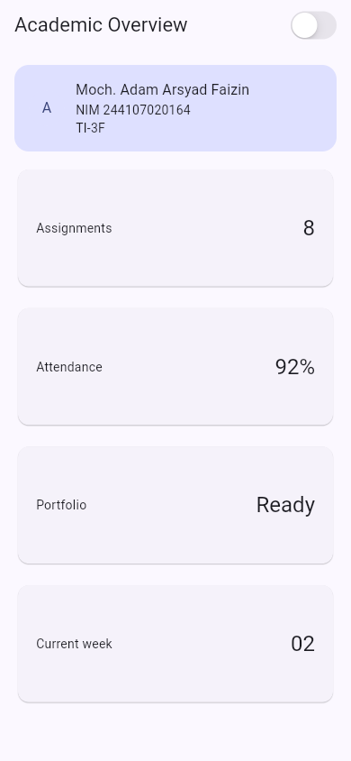
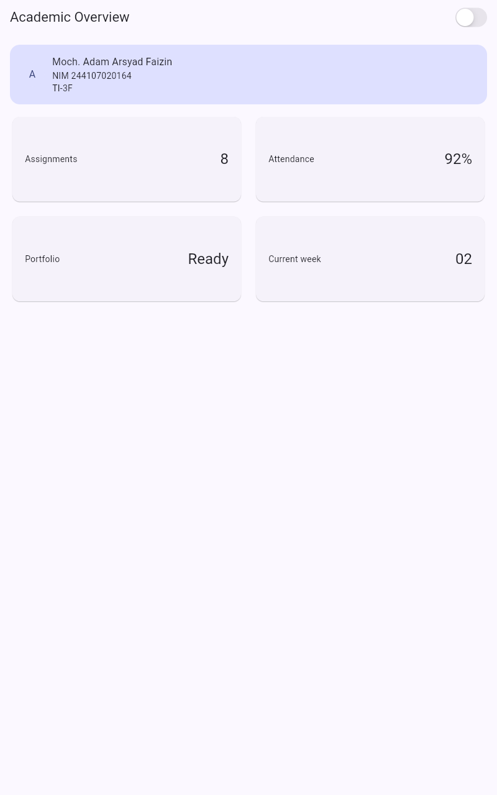
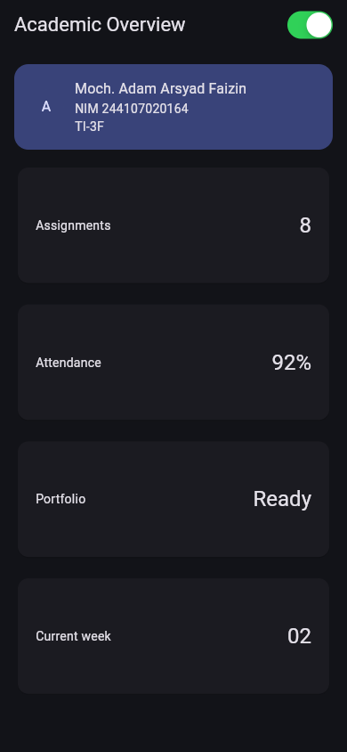

# Week 2 — Declarative UI & Responsive Design

**Nama:** Moch. Adam Arsyad Faizin

**NIM:** 244107020164

## Tujuan dan hasil

Aplikasi **Academic Overview** menampilkan header profil dan empat kartu informasi akademik. Pada lebar di bawah 700 logical pixel, kartu tersusun satu kolom; pada layar yang lebih lebar, dua kolom. Tema terang dan gelap dapat diganti dengan `CupertinoSwitch`. Informasi kartu dan sakelar tema memiliki label semantik.

Kode tugas berada di `lib/main.dart`; project Flutter untuk menjalankannya ada di `responsive_dashboard/`. `InfoCard` digunakan ulang untuk empat kartu, warna dan tipografi mengikuti `Theme.of(context)`, dan breakpoint disimpan dalam `kWideBreakpoint`.

## Menjalankan dan menguji

```bash
cd 02-week-2-declarative-ui-responsive-design/responsive_dashboard
flutter pub get
flutter run
flutter analyze
flutter test
```

`flutter analyze` tidak menemukan issue dan empat widget test lulus: satu kolom pada 390 × 844, dua kolom pada 1200 × 800, pergantian tema, serta label aksesibilitas kartu. Screenshot berikut diambil dari aplikasi yang dijalankan dengan `flutter run -d chrome` pada viewport portrait 390 × 844 (ponsel) dan 800 × 1280 (tablet/lebar).

| Layar sempit | Layar lebar |
| --- | --- |
|  |  |

Tema gelap setelah `CupertinoSwitch` ditekan pada viewport ponsel:



Eksperimen kartu profil pada praktikum awal tersimpan di [Poin 4](screenshots/Poin%204.png) dan [Poin 5](screenshots/poin%205.png). Keduanya berasal dari kode sementara sebelum dashboard akhir.

## AI design exploration

Prompt yang digunakan:

1. “Bandingkan dua tata letak dashboard akademik untuk Flutter: versi `GridView` dan versi `LayoutBuilder` + `Column`. Jelaskan trade-off responsif dan aksesibilitasnya.”
2. “Jelaskan kapan penggunaan `Expanded` justru menyebabkan overflow di dalam `Row`, beri contoh kode yang gagal dan perbaikannya.”
3. “Periksa kembali rekomendasi layout di atas: apakah tetap responsif di bawah 600px, apakah mengurangi aksesibilitas, dan apakah ada widget yang tidak tersedia di Flutter stabil saat ini?”

Ringkasan hasil: `GridView` memudahkan susunan kartu berulang, sedangkan `LayoutBuilder` membaca ruang yang tersedia untuk menentukan jumlah kolom. Keduanya digabung: `LayoutBuilder` memilih 1 atau 2 kolom dan `GridView.count` menata kartu. `Expanded` dipakai di dalam `Row` yang memiliki lebar terbatas; memasangnya pada arah dengan ukuran tak terbatas dapat menyebabkan error layout. Label `Semantics` ditambahkan pada kartu dan sakelar tema agar informasi tidak bergantung pada warna saja. Kode yang dipilih diverifikasi dengan widget test responsif dan screenshot di atas.

## Refleksi

- Pada UI deklaratif, widget dibangun dari state saat ini. Perubahan `isDark` memicu rebuild; komponen tidak diubah satu per satu secara imperatif.
- `Expanded` membagi sisa ruang di `Row` profil dan kartu. Jika parent tidak memberi batas pada sumbu utama, `Expanded` tidak memiliki ruang terhingga untuk dibagi.
- Breakpoint mengubah struktur dari satu menjadi dua kolom. Warna yang mengikuti theme menjaga keterbacaan saat tema berubah.
- Rekomendasi AI dipakai hanya setelah layout, label, dan perilaku tema lolos pengujian.
