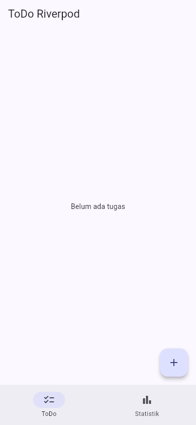
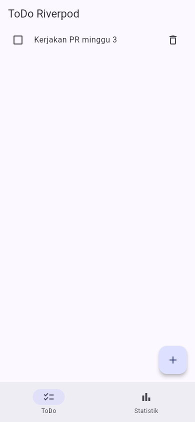
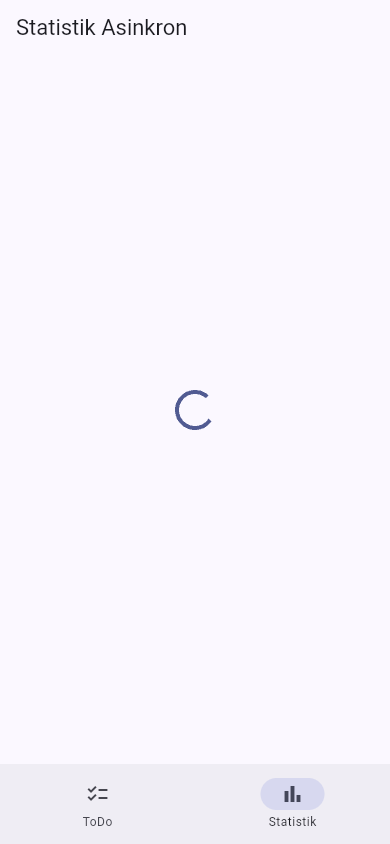
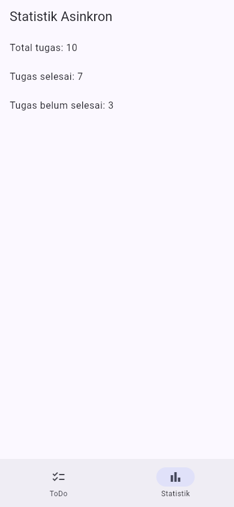
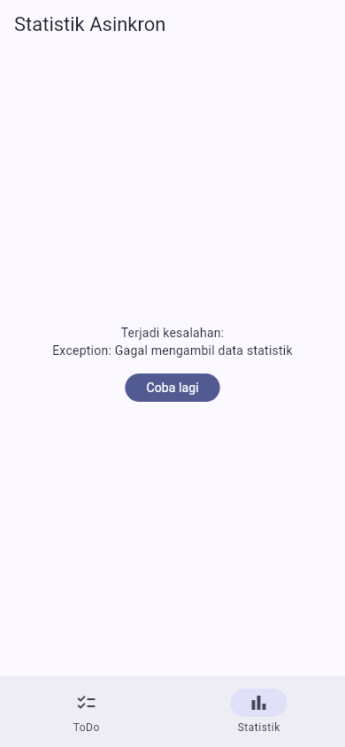

# Week 3 — Navigation & State Management

**Terakhir diperbarui:** 12 Oktober 2026

## Tujuan

Praktikum ini menerapkan navigasi GoRouter, state management Riverpod, AsyncValue, refactoring, dan testing pada aplikasi ToDo.

## Fitur sesuai tugas

- Dua halaman dengan GoRouter: `/` untuk daftar ToDo dan `/stats` untuk statistik.
- `NavigationBar` untuk berpindah halaman.
- State ToDo dikelola dengan `NotifierProvider`.
- UI menggunakan `ConsumerWidget`.
- `TodoTile` dipisahkan dari `TodoPage`.
- `pendingTodoListProvider` menjadi provider turunan yang membaca `todoListProvider`.
- Statistik memakai `AsyncNotifierProvider` dengan delay dua detik dan peluang gagal 30%.
- UI statistik menangani loading, error, dan success.
- Unit test dan widget test.

## Stack teknologi

- Flutter 3.47.1
- Dart 3.13.1
- go_router 18.0.1
- flutter_riverpod 3.4.3
- flutter_test

## Struktur

```text
03-week-3-navigation-state-management/
├── README.md
├── lib/
│   ├── main.dart
│   ├── router.dart
│   ├── pages/
│   ├── providers/
│   └── widgets/
├── test/
│   ├── stats_provider_test.dart
│   ├── todo_provider_test.dart
│   └── widget_test.dart
├── docs/
│   └── ai-challenge.md
└── screenshots/
```

Project Flutter yang dipakai untuk menjalankan kode berada di folder lokal `week3_todo/`.

## Cara menjalankan

```bash
cd 03-week-3-navigation-state-management/week3_todo
flutter pub get
flutter run -d chrome
```

Verifikasi:

```bash
flutter analyze
flutter test
```

## Hasil screenshot

Gambar di bawah diambil dari aplikasi yang dijalankan dengan `flutter run -d chrome` pada viewport ponsel 390 × 844. Statistik memakai peluang gagal 30% dari kode aplikasi; error dan success diperoleh melalui percobaan serta tombol retry, tanpa override provider.

### Daftar ToDo kosong



### Daftar ToDo setelah tugas ditambahkan



Dialog [tambah tugas](screenshots/02-add-dialog.png), [input tugas](screenshots/03-add-input.png), dan hasil [tugas selesai](screenshots/03-todo-completed.png) memperlihatkan perubahan state. Setelah berpindah ke Statistik, [tugas masih ada saat kembali](screenshots/07-back-to-todo.png); tombol hapus mengembalikan [daftar kosong](screenshots/08-todo-deleted.png).

### AsyncValue loading



### AsyncValue success



### AsyncValue error



Tombol Coba lagi membawa halaman kembali ke [loading](screenshots/06-retry-loading.png). Percobaan pertama masih gagal; retry berikutnya menghasilkan tampilan success di atas.

## Hasil pengujian

| Perintah | Hasil |
| --- | --- |
| `flutter analyze` | No issues found |
| `flutter test` | 6 tests passed |
| Tampilan portrait | Diverifikasi pada Chrome viewport 390 × 844 |

Test yang dibuat:

1. `TodoListNotifier` mengubah state secara immutable.
2. Provider turunan hanya menghasilkan tugas yang belum selesai.
3. `StatsNotifier` menghasilkan tiga item ketika sukses.
4. Kegagalan statistik menjadi `AsyncError`.
5. Widget test menambahkan tugas baru.
6. Widget test berpindah ke route `/stats`.

## AI Challenge

Prompt, output awal, hasil verifikasi, dan perbaikan dicatat di [docs/ai-challenge.md](docs/ai-challenge.md).

Checklist:

- [x] State tidak dimutasi langsung.
- [x] `ref.watch` dipakai di dalam `build`.
- [x] Callback memakai `ref.read`.
- [x] Loading, error, dan success ditangani.
- [x] Provider memakai tipe eksplisit.
- [x] Tidak memakai pola Riverpod lama.
- [x] `flutter analyze` dan `flutter test` lulus.

## Refleksi

### Kapan `setState` cukup dan kapan memakai Riverpod?

`setState` cukup untuk state lokal dalam satu widget. Riverpod digunakan ketika state dibaca atau diubah oleh beberapa widget/halaman, perlu bertahan saat navigasi, atau perlu diuji terpisah dari UI.

### Apa perbedaan `context.go` dan `context.push`?

`context.go` mengganti lokasi aktif dan cocok untuk navigasi utama atau redirect. `context.push` menambahkan route di atas stack dan cocok untuk halaman detail yang kembali dengan tombol back.

### Bagaimana `AsyncValue` mencegah bug?

`AsyncValue` merepresentasikan loading, error, dan data sebagai kondisi yang jelas. Pendekatan ini menghindari kombinasi boolean yang tidak konsisten.

### Bagian hasil AI yang diperbaiki

Provider dibuat mudah diuji dengan nilai random dan delay yang dapat dikontrol saat test. Ditambahkan unit test untuk kondisi success dan error, serta dipastikan seluruh state `AsyncValue` ditampilkan.

## Referensi

- [Flutter Navigation](https://docs.flutter.dev/ui/navigation)
- [GoRouter](https://pub.dev/packages/go_router)
- [Riverpod](https://riverpod.dev/)

