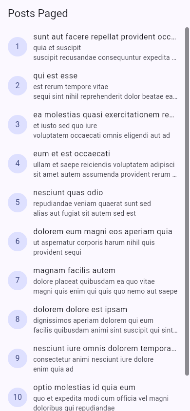

# Week 4 — Networking & REST API

## Tujuan

Membangun aplikasi daftar post dari REST API dengan Dio, repository pattern, Riverpod, penanganan state asinkron, pagination, dan navigasi detail.

## Fitur

- Mengambil data `GET /posts` dari JSONPlaceholder.
- Model `Post` menggunakan `fromJson` yang aman terhadap nilai null.
- Konfigurasi Dio terpusat: base URL, timeout 10 detik, header, dan interceptor logging.
- UI tidak mengakses Dio secara langsung; semua akses melewati repository dan provider.
- State loading, error dengan retry, empty, dan success.
- Infinite scroll 10 item per halaman dengan guard request ganda.
- Halaman detail melalui GoRouter pada `/post/:id`.
- Widget baris dipisahkan menjadi `PostTile`.
- AI Challenge endpoint comments beserta verifikasi dan edge-case test.

## Stack teknologi

- Flutter dan Dart
- Dio
- flutter_riverpod
- go_router
- JSONPlaceholder

## Arsitektur

```text
UI (ConsumerWidget)
        ↓ watch
Provider / Notifier (AsyncValue)
        ↓
Repository
        ↓
Dio → JSONPlaceholder REST API
```

UI hanya membaca provider. Repository menjadi satu-satunya pintu akses API, sedangkan provider mengubah hasil atau exception menjadi state yang dapat ditampilkan UI.

## Struktur

```text
lib/
├── main.dart
├── router.dart
├── data/
│   ├── api_client.dart
│   ├── comment_providers.dart
│   ├── network_errors.dart
│   ├── paged_posts.dart
│   ├── providers.dart
│   ├── models/
│   │   ├── comment.dart
│   │   └── post.dart
│   └── repositories/
│       ├── comment_repository.dart
│       └── post_repository.dart
├── pages/
│   ├── paged_post_page.dart
│   ├── post_detail_page.dart
│   └── post_list_page.dart
└── widgets/
    └── post_tile.dart
```

## Cara menjalankan

Project Flutter lengkap tersedia lokal di folder `week4_api/`.

```bash
cd 04-week-4-networking-rest-api/week4_api
flutter pub get
flutter run -d chrome
```

## Testing

```bash
flutter analyze
flutter test
```

Hasil verifikasi:

- `flutter analyze`: **No issues found**.
- `flutter test`: **8 tests passed**.
- Seluruh provider test menggunakan repository palsu sehingga tidak melakukan HTTP sungguhan.

## Screenshot mobile portrait

Gambar berikut diambil dari aplikasi yang dijalankan dengan `flutter run -d chrome` pada viewport ponsel 390 × 844. Daftar dan detail menggunakan respons JSONPlaceholder yang sungguhan. Untuk menguji error, request ke domain API diblokir sementara pada sesi browser pengujian, lalu tombol retry ditekan setelah blokir dilepas.

### Daftar post dan pagination



### Detail post dengan GoRouter


Setelah kembali ke daftar dan menggulir, [item 11–19 tampil](screenshots/04-pagination.png), membuktikan halaman berikutnya dimuat.

### Error jaringan dan retry


[Loading saat respons API ditahan](screenshots/06-loading.png) dan [daftar kembali setelah retry](screenshots/05-retry-success.png) melengkapi bukti state asinkron. State empty tidak dapat diperoleh dari endpoint `/posts` yang berisi data; `test/post_test.dart` memverifikasi teks empty dengan repository palsu tanpa mengklaim screenshot API nyata. Test yang sama membuktikan guard pagination tidak mengirim request ganda saat pemuatan halaman berikutnya belum selesai.

## AI Verification Checklist

- UI tidak memanggil Dio langsung; akses data melalui repository.
- `Comment.fromJson` aman null dan menerima tipe `num` untuk ID.
- Timeout, connection error, 404, dan 500 dipetakan oleh `friendlyErrorMessage`.
- Base URL dan timeout utama berada di `api_client.dart`.
- Test mencakup field hilang dan edge case ID bertipe desimal.
- Hasil akhir lolos `flutter analyze` dan `flutter test`.

Dokumentasi prompt, output awal, perbaikan, dan hasil verifikasi tersedia di [`docs/ai-challenge.md`](docs/ai-challenge.md).

## Refleksi

### Mengapa UI dilarang memanggil Dio langsung?

Jika widget memanggil Dio langsung, tampilan menjadi terikat pada detail jaringan, sulit diuji tanpa internet, dan konfigurasi/error handling mudah terduplikasi. Repository memisahkan sumber data dari UI sehingga provider dan widget dapat diuji dengan repository palsu.

### Kapan pagination client-side dan server-side digunakan?

Pagination client-side cukup ketika seluruh dataset kecil sudah tersedia di perangkat. Untuk data besar, pagination server melalui `_page` dan `_limit` diperlukan agar penggunaan jaringan, memori, dan waktu muat tetap terkendali.

### Bagaimana exception berubah menjadi AsyncError?

Exception yang keluar dari `build()` milik `AsyncNotifier` ditangkap Riverpod dan disimpan sebagai `AsyncError`. `try/catch` eksplisit tetap diperlukan ketika aplikasi harus mempertahankan data lama saat memuat halaman berikutnya atau melakukan aksi tambahan sebelum menampilkan error.

### Perbaikan hasil AI

Hasil awal diperbaiki dengan memusatkan Dio, memakai cast defensif, memetakan seluruh kategori error yang diminta, menonaktifkan retry otomatis agar test deterministik, serta menambahkan edge-case test selain happy path.
