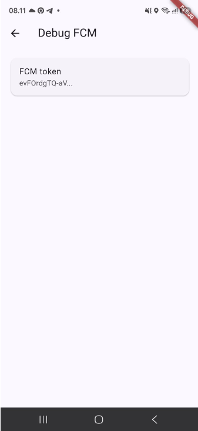
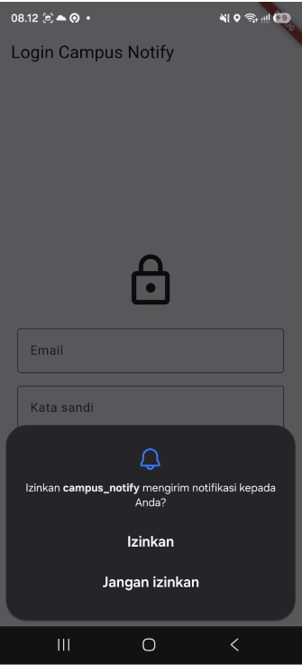
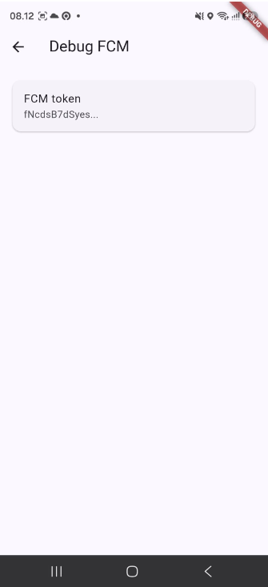
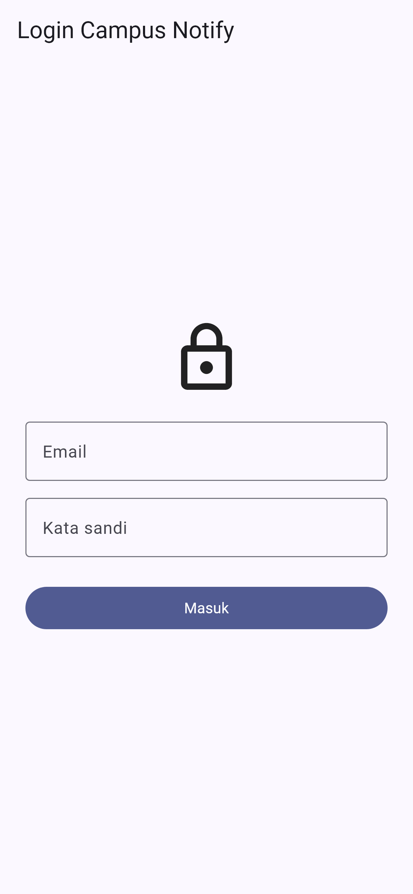
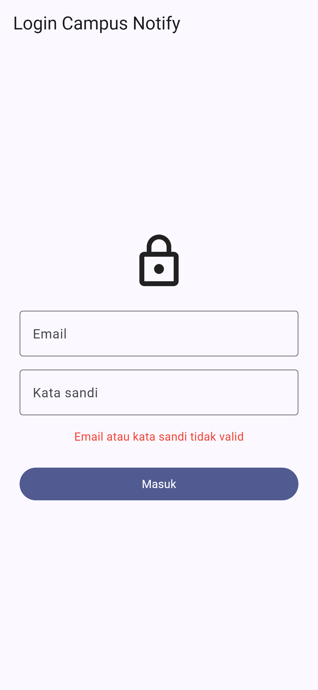
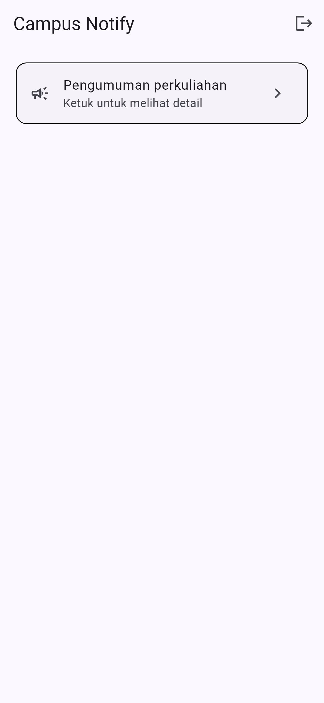
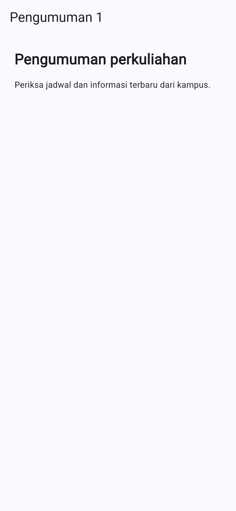

# Week 6 — Authentication, Security, dan FCM

## Praktikum 1: Login, secure storage, dan token refresh

Project **Campus Notify** menerapkan autentikasi mock yang dapat diganti dengan Firebase Auth, menyimpan token secara aman, melakukan refresh access token saat API mengembalikan 401, dan melindungi route menggunakan GoRouter.

## Fitur

- Login dengan validasi email dan kata sandi minimal enam karakter.
- Access token dan refresh token disimpan melalui `flutter_secure_storage`.
- Dio menambahkan header `Authorization: Bearer <token>` secara otomatis.
- Interceptor melakukan refresh token satu kali ketika mendapat status 401.
- Request awal diulang menggunakan access token baru.
- Secure storage dibersihkan jika proses refresh gagal.
- Route guard mengarahkan pengguna yang belum login ke `/login`.
- Pengguna yang sudah login diarahkan dari `/login` ke halaman utama.
- Halaman pengumuman menggunakan path `/pengumuman/:id`.
- Logout menghapus seluruh token dari secure storage.
- FCM menangani pesan saat foreground, background, dan aplikasi dibuka dari notifikasi; hasil runtime masih menunggu uji perangkat.
- Parsing `data.route` dan rute aplikasi dipusatkan agar klik notifikasi dapat diuji tanpa Firebase.

## Struktur

```text
lib/
├── main.dart
├── router.dart
├── routes.dart
├── data/
│   ├── api_client.dart
│   ├── api_errors.dart
│   ├── auth_repository.dart
│   └── token_store.dart
├── providers/
│   └── auth_provider.dart
├── messaging/
│   └── push_service.dart
└── pages/
    ├── announcement_page.dart
    ├── debug_page.dart
    ├── home_page.dart
    └── login_page.dart
```

Dokumentasi AI Challenge dan tabel uji tiga app state ada di [`docs/ai-challenge.md`](docs/ai-challenge.md).

## Alur autentikasi

```text
LoginPage
   ↓ AuthNotifier.login
AuthRepository.login (mock)
   ↓
TokenStore.save
   ↓
flutter_secure_storage
   ↓
GoRouter membuka route yang dilindungi
```

Saat API merespons 401:

```text
401 → baca refresh token → perbarui access token
    → simpan token baru → ulangi request satu kali
    → jika gagal, hapus token dan minta login ulang
```

## Cara menjalankan

Project Flutter lengkap tersedia lokal di folder `campus_notify/`.

```bash
cd 06-week-6-authentication-security-fcm/campus_notify
flutter pub get
flutter run
```

Contoh data login:

```text
Email: mahasiswa@kampus.ac.id
Kata sandi: rahasia
```

Login bersifat mock sesuai instruksi praktikum. Firebase Auth dapat menggantikan isi `AuthRepository.login` setelah konfigurasi Firebase tersedia.

## Firebase Messaging

Dependency `firebase_core`, Firebase Messaging, dan local notification sudah dipasang sesuai persiapan praktikum. `push_service.dart` menangani izin, notifikasi lokal saat foreground, klik notifikasi, token awal, `onTokenRefresh`, dan langganan topik `pengumuman-kampus`. Handler background top-level didaftarkan sebelum `runApp`. Listener token dipasang saat startup aplikasi, bukan setelah halaman Debug dibuka.

Konfigurasi Android yang telah diterapkan pada project lokal `campus_notify/`:

- `google-services.json` berada di `android/app/` dan package name-nya cocok dengan `applicationId` (`com.example.campus_notify`).
- plugin `com.google.gms.google-services` versi `4.5.0` didaftarkan pada `android/settings.gradle.kts` dan diterapkan pada `android/app/build.gradle.kts`;
- core library desugaring diaktifkan sesuai kebutuhan `flutter_local_notifications`;
- `Firebase.initializeApp()` dipanggil setelah `WidgetsFlutterBinding.ensureInitialized()` dan sebelum `runApp()`.

Konfigurasi ini ditujukan untuk Android. Menjalankan melalui Chrome memerlukan pendaftaran aplikasi Web Firebase dan konfigurasi Web tersendiri. Untuk iOS, daftarkan aplikasi iOS di Firebase lalu tambahkan `GoogleService-Info.plist` ke `ios/Runner/` melalui Xcode.

Halaman **Debug FCM** dapat dibuka dari halaman utama dan hanya menampilkan token yang dipotong. Aplikasi meminta izin notifikasi saat startup. Pengiriman token awal maupun perubahan dari `onTokenRefresh` ke `POST /devices` memerlukan URL backend yang dikonfigurasi. Tanpa URL tersebut, token tidak dikirim ke server.

URL backend tidak ditanam di source code. Jalankan atau build dengan URL API kampus:

```bash
flutter run --dart-define=FCM_BACKEND_URL=https://alamat-api-kampus
flutter build apk --debug --dart-define=FCM_BACKEND_URL=https://alamat-api-kampus
```

Pengujian pada perangkat membuktikan token berubah setelah data aplikasi dihapus. Hanya 12 karakter awal token yang ditampilkan:

| Tahap | Bukti | Hasil |
| --- | --- | --- |
| Sebelum clear data |  | Prefix token `evFOrdgTQ-aV...` |
| Setelah clear data |  | Dialog permission muncul kembali, menandakan data/izin aplikasi diinisialisasi ulang |
| Token hasil inisialisasi ulang |  | Prefix token menjadi `fNcdsB7dSyes...` |

Karena prefix sebelum dan sesudah berbeda, rotasi token setelah clear data **terbukti pada perangkat**. Bukti ini belum membuktikan pembaruan `POST /devices` di backend karena endpoint/log backend belum tersedia. Rincian observasi ada di [`docs/fcm-token-lifecycle.md`](docs/fcm-token-lifecycle.md).

## Praktikum 3: payload, app state, dan topik

Payload uji yang sama untuk ketiga app state:

```json
{
  "message": {
    "topic": "pengumuman-kampus",
    "notification": {
      "title": "Jadwal kuliah berubah",
      "body": "Kelas Mobile pindah ke Ruang A2 jam 13.00"
    },
    "data": {
      "route": "/pengumuman/3",
      "id": "3"
    }
  }
}
```

| State | Yang diharapkan | Cara uji | Hasil |
| --- | --- | --- | --- |
| Foreground | Banner lokal; klik ke `/pengumuman/3` | Aplikasi terbuka, kirim pesan, ketuk banner | Belum diuji di perangkat |
| Background | Banner sistem; klik ke `/pengumuman/3` | Tekan Home, kirim pesan, ketuk banner | Belum diuji di perangkat |
| Terminated | Aplikasi terbuka ke `/pengumuman/3` | Tutup aplikasi, kirim pesan, ketuk banner | Belum diuji di perangkat |

Kode sudah mendaftarkan `onMessage`, `onMessageOpenedApp`, dan `getInitialMessage`. Unit test membuktikan parsing route, sedangkan widget test membuktikan tujuan `/pengumuman/3` tetap terbuka setelah login. Test tersebut **tidak membuktikan** banner atau klik FCM nyata. Screenshot banner tiap state dan halaman tujuan dari klik notifikasi belum tersedia.

Aplikasi berlangganan topik `pengumuman-kampus` setelah token diinisialisasi; fungsi berhenti berlangganan juga tersedia di service. Topik dipakai untuk pengumuman broadcast, sedangkan pesan personal seperti nilai atau tagihan harus ditujukan ke token perangkat.

## Testing

```bash
flutter analyze
flutter test
```

Hasil:

- `flutter analyze`: **No issues found**.
- `flutter test`: **11 tests passed**.
- `flutter build apk --debug`: **berhasil**, menghasilkan `build/app/outputs/flutter-apk/app-debug.apk`.
- Test memakai `FakeTokenStore` dan adapter Dio palsu, sehingga tidak mengakses secure storage perangkat, Firebase, backend, atau internet.

## Screenshot UI portrait yang sudah tersedia

Gambar di bawah menunjukkan halaman aplikasi, bukan hasil pengiriman atau klik FCM. Screenshot lifecycle token di atas berasal dari perangkat; screenshot banner ketiga app state masih menunggu uji perangkat.

### Halaman login



### Validasi login gagal



### Halaman setelah login



### Detail pengumuman



Bukti perubahan token setelah clear data sudah tersedia. `screenshots/fcm-console-test.png` dan log penerimaan token baru di backend masih belum tersedia.

## Verifikasi AI Challenge

- Handler background berupa fungsi top-level dengan `@pragma('vm:entry-point')`, tanpa akses `BuildContext`.
- `getToken` dan `onTokenRefresh` memakai callback upload yang sama ke `POST /devices` bila URL backend disediakan. Perubahan token setelah clear data sudah terbukti; keberhasilan pengiriman ke backend belum dibuktikan.
- Foreground memakai local notification manual; background dan terminated memakai handler klik FCM masing-masing.
- Parsing route, retry 401, dan pemulihan tujuan setelah login lulus test. Ketiga app state belum teruji dengan pesan FCM nyata.
- Token penuh tidak dicetak ke log maupun ditampilkan di halaman Debug.
- Draf awal, perubahan manual, alasan, dan matriks uji dicatat di [dokumentasi AI](docs/ai-challenge.md).

## Refleksi

- Refresh token berada di secure storage karena kebocorannya memungkinkan pihak lain membuat access token baru; SharedPreferences tidak dirancang untuk rahasia.
- Tanpa `onTokenRefresh`, backend dapat terus mengirim ke token yang sudah tidak berlaku sehingga pengumuman tidak diterima.
- Topik cocok untuk pengumuman seluruh kampus; pesan pribadi seperti nilai dikirim ke token perangkat yang terkait dengan pengguna.
- Draf AI awal ditolak sebagai hasil akhir karena belum menangani tiga app state dan listener token baru hidup setelah halaman Debug dibuka. Keduanya diperbaiki dalam service dan diuji sejauh tanpa perangkat.

## Catatan keamanan

- Token tidak disimpan di SharedPreferences.
- Access dan refresh token hanya keluar-masuk melalui `TokenStore`.
- Simulasi token pada codelab bukan JWT produksi dan tidak boleh dianggap sebagai token yang sudah diverifikasi.
- Refresh request diberi penanda `retried` agar respons 401 berulang tidak membuat loop tanpa batas.
